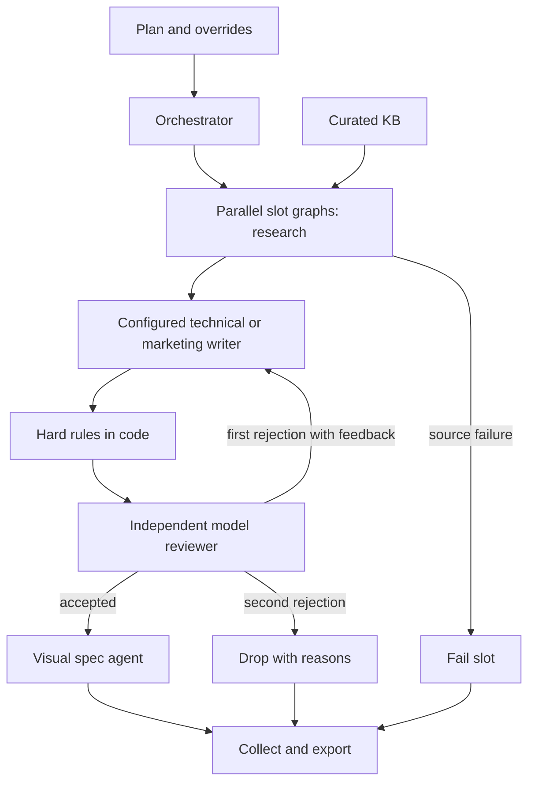

# Architecture

The orchestrator owns scheduling and aggregation. It never writes content.
Each slot gets an isolated LangGraph state machine; `asyncio.gather` runs those
machines concurrently behind a semaphore. The same reusable graph is invoked
with separate state dictionaries. Results are collected in plan order.

## Roles and handoffs

| Role | Input | Output | Boundary |
|---|---|---|---|
| Orchestrator | Validated plan and config | Isolated slot runs and export | No creative decisions |
| Research | Focus and matching KB candidates | Validated KB ID, reason, evidence | No drafting or unsupported fallback |
| Technical writer | Evidence, voice, dedicated prompt | 5–10 cited tweets | No self-approval |
| Marketing writer | Evidence, voice, dedicated prompt | One cited post | No fabricated stats |
| Reviewer | Entire draft, actual evidence, rubric, hard results | Scores, per-unit quotes and support, reasons, approval | No rewriting |
| Visual | Accepted piece and shared image brief | Typed concept, code-composed prompt and alt text | No work on rejected pieces |

Two writer agents are prompt-configured instances of the same runner, not two
copies of near-identical Python code. Their instructions and count constraints
are separate. LangChain performs typed structured generation; LangGraph makes
branching, one retry and terminal states visible. Research is intentionally
bounded by retrieved candidates, so even an erroneous model choice cannot
introduce an unregistered source.

`search_kb` resolves candidates. `evidence_for` is shared by research and review:
the reviewer rebuilds evidence from the authoritative KB snapshot instead of
trusting the writer's citation content. The image-brief skill is loaded by both
writers and the visual agent. Skills and prompts are normal versioned files.

## Code versus judgment

Code validates inputs, IDs, count limits, ASCII text length, punctuation,
hashtags, banned phrases, links, duplicate tweets, CSV formula prefixes, reference
existence, complete reviewer coverage, score thresholds and retry limits.
Changing brand rules or acceptance thresholds requires no Python edits.

The reviewer judges whether the *whole text* is actually supported by the
supplied evidence and whether it is useful, clear and on-brand. Citing a valid
KB ID alone is never proof of support. Every post needs one explicit semantic
support decision. Hard-rule failure cannot be overridden by a high model score.
A false approval remains possible: this is a model-assisted gate, not a proof
system. Human security review is the next step before real publication.

## Failures, concurrency and costs

One piece owns its drafts and feedback. After its first rejection the same
writer receives the rejected draft and concrete reasons. After a second rejection
it terminates without a visual. Source, writer, reviewer or visual exceptions
fail only that slot. A visual failure means the piece is not exported, ensuring
every shipped piece has an accompanying spec. Configuration failures stop early.

Concurrency is bounded by whole pieces. The optional shared token gate further
serializes budgeted API calls while slot workflows remain concurrent. A 60-second provider request timeout prevents indefinite
network waits. SDK retries are disabled. The adapter implements separately logged HTTP 429
retries, honors Retry-After where available, and uses bounded exponential
backoff otherwise. This does not consume an editorial attempt. Atomic JSON writes prevent partially written files. The audit snapshot
is not a resumable LangGraph checkpointer.

Per-call usage comes from raw LangChain response metadata, even when typed
parsing fails. Unknown usage stays unknown and incomplete totals are labeled.
Cost uses explicit model rates rather than a stale hardcoded price list. Prompts,
KB and policies are snapshotted and hashed for reproducibility. Model outputs are
not reproducible bit-for-bit. Secrets and raw provider exception bodies are not
written to logs.

## Growth

**15 slots:** change the plan only. There are 15 initial KB entries; unique empty
slots consume unused entries. Add source entries when topic supply is exhausted.
Keep concurrency bounded; introduce provider-specific rate limits and separately
budgeted backoff if throughput requires it. For large runs, use persistent
checkpointing and a job queue rather than holding all artifacts in memory.

**Another text type:** add its manifest and writer prompt. The orchestrator
uses the registry. **Another platform:** introduce platform policy and exporter
interfaces for that platform's length, media and thread model. Existing typed
post records and evidence can remain; changing platform semantics deserves
explicit code rather than hidden prompt changes.

**Another provider:** implement `generate(role, prompt, payload, schema, slot)`
and expose the usage ledger, model, mode and rates. **Another agent:** implement
a node with validated input/output, add explicit graph routing and failure tests.
**Real visuals:** replace the spec adapter with an image API, preserve the spec,
log image cost and export media paths or approved URLs.

## Technical references

- [LangGraph StateGraph](https://reference.langchain.com/python/langgraph/graph/state/StateGraph)
- [LangChain structured OpenAI output](https://reference.langchain.com/python/langchain_openai/chat_models/base/ChatOpenAI/with_structured_output)
- [OWASP smart contract weakness catalog](https://scs.owasp.org/SCWE/)
- [Solidity security considerations](https://docs.soliditylang.org/en/latest/security-considerations.html)

These are design/background references. Runtime grounding is explicitly the
versioned local KB and brand input, not a live retrieval from these pages.

## Streamlit and stronger evidence gates

Streamlit is a thin client of the same `run_week` function used by the CLI.
`ui_jobs.py` starts a background job with a process-wide single-job lock; only
its event queue is read by the UI. Background code never calls Streamlit APIs.
A fragment refreshes progress without blocking provider budget waits. Configuration
is captured before launch, so later file edits cannot change a running job.
`ui_files.py` validates edits before atomic replacement and bundles only run artifacts.
API keys are passed in memory; no session secrets enter the input snapshot.

The reviewer classifies every deterministic sentence/semicolon unit and supplies
verbatim evidence quotes. Code checks full unit coverage, existing writer citations,
exact quotes and approved CTAs. Scope markers such as 'often', 'all' and 'will'
produce advisory warnings for the model, not automatic rejections. Semantic
support remains model judgment. Detailed KB facts
include primary-source URLs, preserved in research provenance, but are curated
inputs rather than pages fetched during a run.

The visual agent selects a source, layout and symbol from a typed schema. The
shared visual skill composes a prompt from `visual-style.json`; it forbids all
visible text. Freeform model instructions cannot introduce contradictory labels.
This ensures structural consistency, not visual fidelity in a future renderer.

## Presentation layer

The Streamlit studio reuses the same orchestrator and providers. CSS is isolated
in `assets/studio.css`; `pipeline/ui_design.py` escapes generated text before
rendering readable preview cards. Search and type filters operate on saved
accepted content only. History sorts by recorded run time. This layer cannot
change review decisions or include dropped content in an export.
