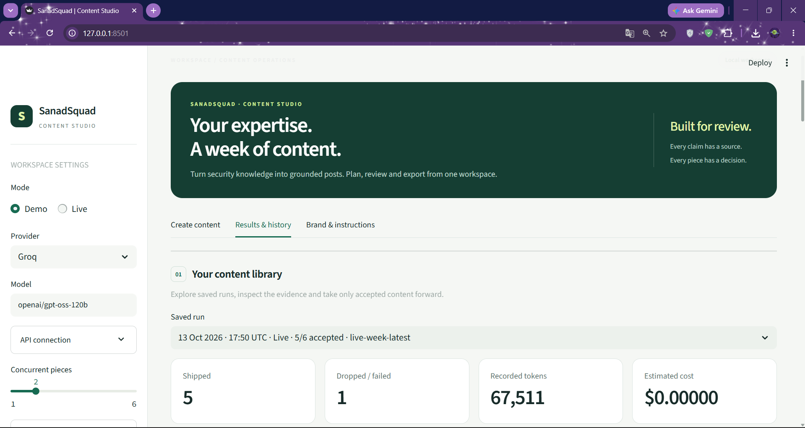
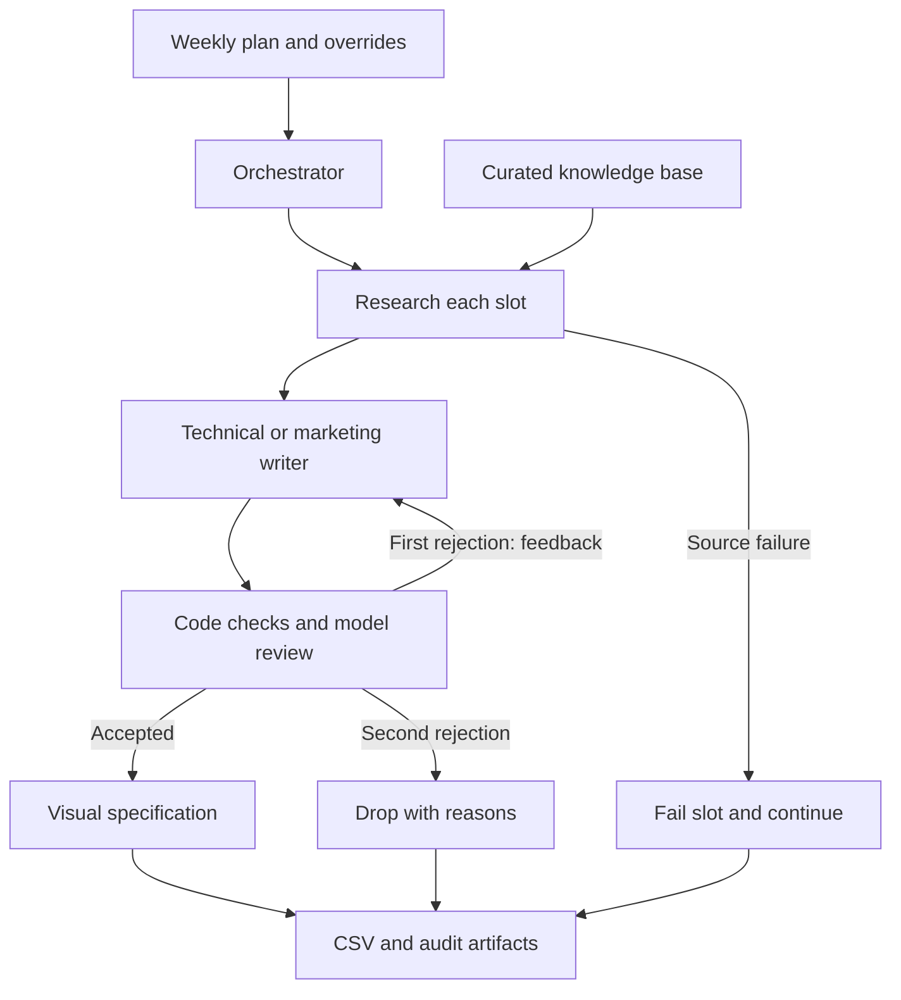

<div align="center">

<br>


<br>


### Your expertise. A week of content.

**A multi-agent system that turns smart contract security knowledge into reviewed X threads and marketing posts.**

Research with sources. Write in the brand's voice. Review before export.

[Quick Start](#quick-start) · [Architecture](ARCHITECTURE.md) · [Live Sample](output/live-week-latest) · [Known Limitations](LIMITATIONS.md)

</div>

---

## ✦ App Preview

<p align="center">
  
</p>

A local workspace to edit the weekly plan, follow agent activity, inspect posts and evidence, and download the accepted content. **Nothing is published automatically.**

---

## ✦ What Is This?

Preparing useful security content takes more than generating text. Topics need sources, technical claims need checking, and every post needs to follow the brand's rules.

**SanadSquad Content Studio** splits that work between specialised agents. The default plan contains **three technical threads and three marketing posts**. A thread contains **5–10 tweets**. You can set each topic or leave it blank for automatic selection from the knowledge base.

A rejected piece gets **one rewrite with feedback**. If it fails again, it is dropped. Only accepted pieces receive a visual specification and appear in the final CSV.

| Orchestration | Model adapter | Knowledge | Interface | Export |
|:---:|:---:|:---:|:---:|:---:|
| LangGraph + asyncio | LangChain / OpenAI-compatible API | 15 curated vulnerabilities | Streamlit + CLI | CSV + JSON audit trail |

---

## ✦ Meet the Agents

| Role | Responsibility | Handoff |
|:---|:---|:---|
| **Orchestrator** | Apply the plan, schedule independent slots in parallel, collect results | Isolated slot workflows |
| **Research agent** | Resolve topics from the KB and record their provenance | Topic, evidence IDs and source text |
| **Technical writer** | Explain a vulnerability in a connected 5–10 tweet thread | Draft with evidence references |
| **Marketing writer** | Write a concise, brand-aligned marketing post | Draft with evidence references |
| **Reviewer** | Score accuracy, usefulness, clarity and brand fit; check support | Accept/reject decision and feedback |
| **Visual agent** | Choose a supported visual concept for accepted content | Written image specification |

The writers have separate instruction files. Reusable skills live in `pipeline/skills/`; evidence lookup is shared by research and review, and the image brief is shared by writers and the visual agent.

---

## ✦ How It Works



Slots run independently with bounded concurrency. A failure in one does not stop the others. A shared local token budget can pace provider calls even while multiple slot workflows are active.

**Automatic topic selection is not random:** empty slots reserve unused KB entries in plan order. Live wording can vary between runs; the offline demo uses deterministic fixtures.

---

## ✦ Quality by Design

| Check | Where it belongs |
|:---|:---|
| Post count, character limits, banned punctuation, hashtags and links | Python validators |
| Evidence ID validity, exact source quotes and complete review coverage | Python validators |
| Meaning, qualifications, usefulness and brand fit | Model reviewer |
| Approval thresholds and one editorial retry | Code, configured by files |
| Scope words such as “always” or “any” | Advisory flags for contextual review |
| Visual source, layout and symbol constraints | Typed output + template composition |

Grounding checks reduce unsupported output; **they do not guarantee factual correctness**. The model can still miss nuance or reject valid wording. Historical drafts and decisions remain available for inspection.

The KB is the runtime source. Its URLs document provenance; this version **does not fetch web pages during a run**. Severity labels are illustrative test data, not universal ratings.

---

## ✦ Included Live Run

The complete, unmodified run is available in [`output/live-week-latest/`](output/live-week-latest).

| Metric | Recorded result |
|:---|:---|
| Mode / model | Live / `openai/gpt-oss-120b` via Groq |
| Requested | 6 pieces |
| Accepted | 5: two technical threads and three marketing posts |
| Dropped | 1 technical thread after two editorial attempts |
| API calls | 27 |
| Input / output tokens | 40,159 / 27,352 |
| Recorded rate-limit responses | 0 |
| Elapsed time | About 21 minutes 39 seconds |
| Cost | $0 estimate at configured zero token rates; not billing verification |

The dropped thread's final draft contained disallowed Unicode hyphens and an unsupported state-corruption claim. Its first review also incorrectly treated an advisory scope word as prohibited. Both decisions are preserved as evidence of the system's behavior and limitations.

**A complete run does not require every piece to pass.** Rejected content stays out of the export.

[`output/sample-week/`](output/sample-week) provides an offline demo. Its content and scores are fixtures, not live model evaluation.

---

## ✦ Project Structure

```text
sanad-content-pipeline/
├── app.py                 # Streamlit entry point
├── run_week.py            # Weekly CLI
├── run_piece.py           # Single-piece CLI
├── launch_ui.bat          # Windows launcher
├── brand-voice.md         # Voice and machine-readable brand rules
├── kb.json                # 15 vulnerability entries and supporting facts
├── plan.json              # Six default content slots
├── rubric.json            # Review thresholds
├── visual-style.json      # Visual templates and allowed concepts
├── pyproject.toml
├── requirements.lock
├── .env.example
├── pipeline/              # Graph, orchestration, providers and UI helpers
│   └── skills/            # Reusable research, validation and visual skills
├── post_types/            # Type manifests and separate writer instructions
├── prompts/               # Research, reviewer and visual instructions
├── assets/                # Local UI stylesheet
├── .streamlit/            # Local server and theme configuration
├── schemas/               # JSON Schema contracts
├── scripts/               # Schema export utility
├── tests/                 # Automated tests and regression fixtures
├── docs/                  # UI guide, artifact contract and test report
├── photo/1.png            # Interface screenshot
└── output/                # Complete sample runs
```

---

<a id="quick-start"></a>

## ✦ Quick Start

**Python 3.11+** is required. Clone or download this repository, then open a terminal in its root folder.

### 1. Install

```bash
python -m venv .venv
```

Activate on **Windows PowerShell**:

```powershell
.\.venv\Scripts\Activate.ps1
```

Or on **Linux / macOS**:

```bash
source .venv/bin/activate
```

Install the tested dependency set:

```bash
python -m pip install -r requirements.lock
```

### 2. Open the studio

```bash
python -m streamlit run app.py
```

On Windows, you can instead double-click **`launch_ui.bat`**. It uses the local virtual environment if available and installs dependencies when its dependency check fails.

Open **http://127.0.0.1:8501**. Keep the launcher running while the app is in use.

### 3. Try Demo, then Live

- **Demo:** no API key; demonstrates the workflow with offline fixtures.
- **Live:** select your provider and model; supply credentials through `.env` or the masked sidebar field.
- **Create content:** edit slots and run a whole plan or one piece.
- **Results & history:** search accepted posts, inspect evidence and reviews, download CSV/ZIP.
- **Brand & instructions:** validate and save instructions for future runs.

Only one UI job runs at a time across browser tabs. Slots within that job can still run concurrently.

---

## ✦ API Configuration

Create `.env` beside `app.py`. For the Groq configuration used in the sample:

```dotenv
OPENAI_API_KEY=your_groq_api_key_here
OPENAI_BASE_URL=https://api.groq.com/openai/v1
LLM_MODEL=openai/gpt-oss-120b
LLM_TOKENS_PER_MINUTE=7500
LLM_MAX_COMPLETION_TOKENS=4096
LLM_RATE_LIMIT_RETRIES=3
```

The variable is named **`OPENAI_API_KEY` even when using Groq**, because the adapter uses an OpenAI-compatible client. Use your own provider's key; no credentials are included.

For OpenAI, set your OpenAI key, use `https://api.openai.com/v1`, and choose a supported structured-output model. The adapter's default model is `gpt-4.1-mini`. The UI explicitly uses the provider and model selected in its sidebar.

Optional settings:

| Variable | Purpose |
|:---|:---|
| `INPUT_USD_PER_MILLION` / `OUTPUT_USD_PER_MILLION` | Both rates for cost estimates; omit for unknown cost |
| `LLM_TOKENS_PER_MINUTE` | Process-local budget; `0` disables local pacing |
| `LLM_MAX_COMPLETION_TOKENS` | Completion reservation and output cap |
| `LLM_RATE_LIMIT_RETRIES` | Bounded HTTP 429 retries, separate from editorial retries |
| `LLM_RETRY_BASE_SECONDS` / `LLM_MAX_RETRY_WAIT_SECONDS` | Backoff controls |
| `LLM_REASONING_EFFORT` | Optional, only for models supporting this setting |

The 7,500-token budget is a **local pacing setting**, not a statement of your account's quota. It cannot account for other processes or bypass daily limits. Missing usage remains unknown; cost is an estimate at configured rates.

**Keep `.env` private.** `.env.example` contains placeholders only, and run downloads exclude credentials.

---

## ✦ Command-Line Usage

```bash
# Offline weekly demonstration
python run_week.py --mode demo --plan plan.json --output output/local-demo

# Live weekly plan
python run_week.py --plan plan.json --output output/week-42 --concurrency 2

# Override one slot's topic
python run_week.py --plan plan.json --set thread_2="oracle manipulation"

# Generate one technical thread
python run_piece.py --type tech-thread --topic "reentrancy"
```

Repeat `--set` for multiple overrides. An empty focus enables automatic topic selection. Unknown topics fail visibly rather than silently substituting another subject.

Output folders must be new. Omit `--output` for an automatically generated folder. `--config-dir` selects an alternate configuration; use `--plan` too when that configuration has its own plan.

Exit codes: **0** all shipped · **1** completed with dropped/failed pieces · **2** setup/configuration error.

---

## ✦ What Gets Exported?

| Artifact | Purpose |
|:---|:---|
| `posts.csv` | Accepted content, with exactly `Post Text` and `Image` columns |
| `final_content.json` | Accepted pieces and individual tweets with evidence IDs |
| `input_plan.json` / `input_snapshot.json` | Effective plan and exact configuration snapshots |
| `resolved_plan.json` / `research_log.json` | Selected topics and source evidence |
| `drafts.json` / `review_report.json` | Draft history, scores, feedback and decisions |
| `run_summary.json` / `usage.json` / `events.json` | Outcomes, recorded tokens, estimated cost and activity |
| `pieces/<id>/state.json` | Diagnostic state after completed nodes |
| `visuals/<id>.json` | Written image prompt, alt text and supporting context |

**One CSV row represents one piece.** Thread tweets are separated by blank lines inside the text cell. `Image` points to a relative JSON specification, **not rendered media**. Render the brief and adapt thread/media formatting to your scheduling tool before import. The app does not schedule or publish posts itself.

---

## ✦ Extend Without Rewriting the Orchestrator

Add a folder such as `post_types/checklist/` with a `writer.md` instruction file and a `type.json` manifest:

```json
{
  "name": "checklist",
  "min_posts": 1,
  "max_posts": 1,
  "max_characters": 280,
  "writer": "writer.md"
}
```

Use `checklist` in the plan. The existing runner loads the new type automatically. This supports new text formats within the current schema; a genuinely new agent role or platform workflow needs explicit code.

Brand voice, review thresholds, prompts and visual style are separate files. See [ARCHITECTURE.md](ARCHITECTURE.md) for scaling to 15 slots and adding another platform.

---

## ✦ Tests & Documentation

```bash
python -m pytest -q
python scripts/export_schemas.py
```

**73 tests passed in the build environment.** Coverage includes editorial retries, permanent rejection, source failures, independent slot execution, rate-limit handling, usage uncertainty, evidence checks, file-based extension and Streamlit interactions.

The latest live sample predates only the UI presentation refresh. That refresh was checked with Streamlit AppTest; browser screenshot validation was unavailable in the build environment.

| Document | Read it for |
|:---|:---|
| [Architecture](ARCHITECTURE.md) | Agent boundaries, data flow and trade-offs |
| [UI Guide](docs/UI_GUIDE.md) | Local operation and recovery |
| [Artifact Contract](docs/ARTIFACTS.md) | JSON layouts and schema versions |
| [Test Report](docs/TEST_REPORT.md) | Executed checks and validation limits |
| [Submission Guide](docs/SUBMISSION.md) | Evaluation map and demonstration walkthrough |
| [Known Limitations](LIMITATIONS.md) | Current constraints and next work |

---

## ✦ Troubleshooting

| Problem | What to do |
|:---|:---|
| Missing API key | Create `.env` or enter the key in the sidebar; use `OPENAI_API_KEY` for the compatible adapter |
| “Provider budget: waiting” | Leave the run active; local pacing is waiting for budget capacity |
| Repeated HTTP 429 responses | Check your account/model limits and other processes sharing the key |
| A piece is dropped | Inspect both attempts in Reviews; a second rejection deliberately prevents export |
| Topic has no source | Choose a KB topic or add a grounded entry before running |
| Output folder already exists | Choose a new folder; past runs are protected from overwrite |
| Missing dependency | Run `python -m pip install -r requirements.lock` in the active environment |

---

## ✦ Known Limits & Next Steps

- Model review remains fallible; broaden human-labelled evaluations and improve repair consistency.
- Retrieval uses the local KB; add verified web retrieval with saved source snapshots.
- Visuals are specifications; add an image provider and media validation.
- Execution is process-local and not resumable after server shutdown; add durable jobs and shared budgets.
- X formatting uses a conservative ASCII policy; add weighted Unicode length handling.
- CSV needs scheduler-specific adaptation; add and test a dedicated scheduler exporter.

The studio is intended for a **trusted local user**. Public hosting would need authentication, secret isolation and durable job management.

---

<div align="center">

Built by **[Morad Elnahla](https://github.com/morad-elnahla)**

*SanadSquad Content Studio — plan with intent, review with evidence, export with a trail.*

</div>
